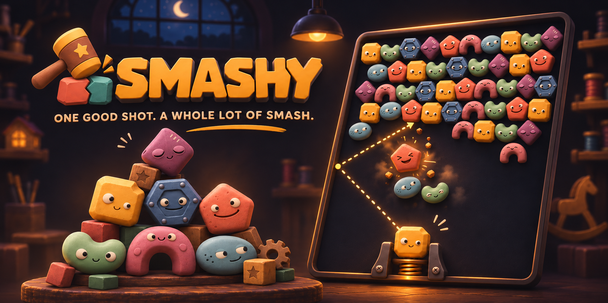
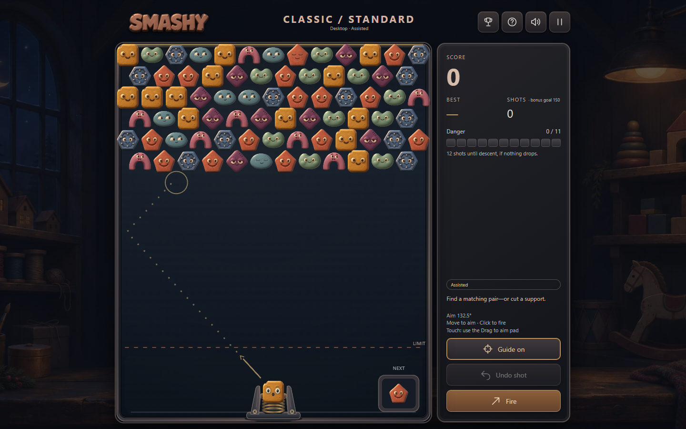
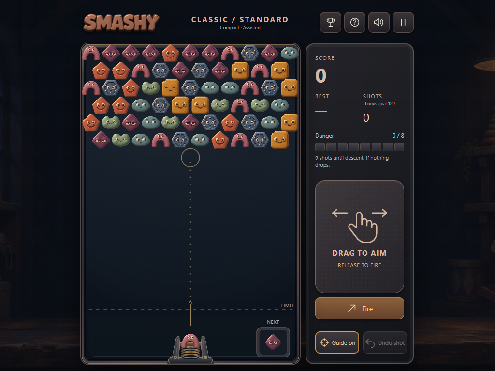
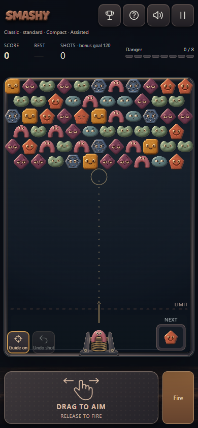

# Smashy

**One good shot. A whole lot of smash.**

## [▶ Play Smashy in your browser](https://jimerb.github.io/Smashy/)

No download or account needed. Open the game, then try **Learn by smashing**.



Line up a shot, connect a few friendly toys, and find the support that brings a whole cluster tumbling down. Smashy is a browser puzzle game with a quiet workshop atmosphere, expressive characters, satisfying breaking sounds, and no timer rushing your next move.

**[Quick start](#quick-start)** · **[How to play](#how-to-play)** · **[Controls](#controls)** · **[Run locally](#run-locally)**

## Quick start

1. **Try Learn by smashing.** Three tiny boards introduce matching, support drops, and wall rebounds.
2. **Choose Classic.** Relaxed is a comfortable place to start. Pick the Standard board layout for a desktop, or Compact for a smaller screen.
3. **Aim at a matching pair and fire.** Three touching toys of the same type break apart.
4. **Look above the obvious match.** Remove the few toys holding up the many, and watch the unsupported cluster fall.

No account is required. Your personal scores and one resumable game stay in your browser.

## Screenshots



<details>
<summary><strong>See the tablet and phone layouts</strong></summary>

<p>
  
  
</p>

</details>

These show the actual game. The tablet and phone views were captured at representative sizes in a desktop browser; they are not physical-device test results.

## How to play

### Connect three. Cut the support.

A match is a **connected group of three or more toys of the same type**. It can bend around a corner; it does not need to form a straight row.

Every toy needs a chain of neighbors back to the ceiling. Break that chain and all unsupported toys drop together, including different types. Those big drops are where the points are.

The charcoal **Anchor** obstacle cannot be matched or launched. Cut its support to drop it—or clear the ordinary toys around it to finish the board.

### Use the walls

Shots bounce off the side walls. A bank shot can reach a useful support that a direct shot cannot. Ricochets are ordinary shots, with no power-up needed. Check **Next** before deciding what to set up.

### Watch danger, not the clock

There is no time limit. Each settled shot adds **1 danger**; every dropped toy removes **2**, down to zero.

A full meter is a warning. The board descends only when danger goes **over** its threshold after drops are counted. Descent moves the existing board down and resets danger. Reaching the limit line or completely filling the lowest row ends the run; clearing all ordinary toys wins the board.

### A bonus goal is not a shot limit

Puzzles unlock when you **clear the board**, even if you use more shots than the bonus goal. Finishing farther below that goal earns a larger efficiency bonus. Every clear earns at least **+100 efficiency points**, plus the clear bonus.

**Retry same board** repeats the original layout and toy order. **New random board** generates a fresh Classic board at the same difficulty and layout size. Finished and zero-score games start their replacements directly; an unfinished game with a positive score asks before being replaced.

<details>
<summary><strong>Show exact scoring</strong></summary>

| Action | Points |
| --- | ---: |
| Match `n` toys, with `n ≥ 3` | `min(n² + 1, 10,000)` |
| Drop `d` toys in one shot | `min(10 × d², 10,000)` |
| Clear the board | `1,000` |
| Efficiency on clear | `100 × max(1, bonus goal − shots used)` |

For example, matching three and dropping four earns **10 + 160 = 170 points**, before any clear bonuses. All groups dropped by the same shot count together; the match and drop caps are separate.

</details>

## Controls

| Play your way | Aim | Fire |
| --- | --- | --- |
| Mouse | Move over the board | Primary click |
| Keyboard | Left / Right arrows; hold Shift for fine aim | Space or Enter |
| Phone or tablet | Slide left or right on the separate **Drag to aim** card | Lift your finger |
| Separate Fire mode | Aim first; enable this option in Settings | Press **Fire** |

On touch, a captured drag keeps aiming after your finger leaves the card. Release over **Cancel** to cancel the shot. A small tap does not fire.

**Escape** pauses; **M** toggles sound. The top controls open personal scores, Help, sound, and Pause. Help includes illustrated examples you can replay without spending a real shot.

Want a little help lining things up? **Guide** previews the full path, including rebounds. **Undo** restores the previous settled shot. Either marks the attempt **Assisted**, with its own record category; turning Guide off does not remove that marker.

## Pick your kind of game

| Mode | The idea |
| --- | --- |
| **Classic** | One random board, five difficulties, and another chance to improve your approach. |
| **Puzzles** | Fifty original authored boards. Clear to unlock the next; revisit completed puzzles. |
| **Journey** | Carry your score through increasing difficulties, then keep going at Expert until the run ends. |
| **Custom** | Choose validated dimensions, toy types, Anchors, starting rows, danger, and a bonus goal. |
| **Learn by smashing** | Three short practice boards: make a match, cut a support, and bank a shot. |

## A comfortable place to play

Smashy defaults to a dark theme with muted accents. Settings include sound volume, reduced motion, color intensity, board brightness, extra shape marks, and a **Simple backdrop** that removes the workshop decoration.

The complete playfield scales to the available screen. Compact layouts and a separate touch aiming card help keep your hand away from the board. If a board cannot fit readably, the game preserves it and asks for more room rather than cropping the launcher or shrinking the toys too far.

Desktop Chrome and Edge are the primary play targets, with Firefox checks as well. Phone and tablet layouts support touch; broader physical-device testing is ongoing.

## Your scores, your browser

The trophy opens your personal top ten and recent results. Records are separated by mode, difficulty, layout, configuration, and assistance so unlike runs are not mixed. Classic records a finished board; Puzzles and Journey record the whole run rather than each intermediate clear.

Scores, settings, and the resumable game are stored locally. Another browser, browser profile, device, or site address has separate data. Clearing site data removes it. There are no accounts, cloud saves, or global leaderboards in this version.

## Run locally

You need an existing **Node.js 24 or newer** runtime and **pnpm 11.25.0**, the version pinned in `package.json`. Dependencies are installed inside the project; the game needs no separate game engine or database.

```sh
git clone https://github.com/jimerb/Smashy.git
cd Smashy
pnpm install --frozen-lockfile
pnpm build
pnpm start
```

Open **[http://127.0.0.1:5173/](http://127.0.0.1:5173/)**. Keep the server running while you play. This serves the built game without live reload.

On Windows, after building, you can also use `Start-Smashy.cmd`. To test from another device on the same local network:

```sh
pnpm start -- --host 0.0.0.0
```

Open `http://<your-computer-LAN-IP>:5173/` on that device. Keep using the same site address for the same local scores. Network and firewall access must allow the connection.

For source development with live reload:

```sh
pnpm dev
```

The development server uses port **5174**. Its different address has separate browser-local saves and records.

## Development and checks

The [Pages workflow](.github/workflows/pages.yml) tests, builds and audits the game on pushes to `main`, then publishes only the static `dist/` output to GitHub Pages. It can also be run manually from the repository's Actions tab. No game server or account backend is required for hosted play.

Smashy uses **TypeScript, PixiJS, Vite, HTML/CSS, IndexedDB, and Web Audio**. The deterministic rules are separate from rendering, sound, and storage.

```sh
pnpm test             # Rules, content, replay, and persistence tests
pnpm build            # Type-check and build the static player
pnpm audit:build      # Check the production asset allowlist

# With the built game served in another terminal:
pnpm test:browser     # Installed Chrome; no browser download
pnpm test:pc -- --full
```

`SMASHY_URL` selects the running game URL for browser checks. Tests that support `SMASHY_BROWSER=msedge` use installed Edge. The full PC suite also plays all fifty Standard puzzles. Browser automation verifies specific behavior; it does not establish enjoyment or replace physical-device testing.

| Location | What is inside |
| --- | --- |
| `src/core/` | Board rules, collisions, matching, drops, danger, and scoring |
| `src/content/` | Teaching boards and the original puzzle catalog |
| `src/render/` | Characters, launcher, effects, and presentation |
| `src/audio/` | Original procedural sound synthesis |
| `src/persistence/` | Local records, checkpoints, and ownership protection |
| `src/ui/` | Illustrated Help |
| `tests/` | Deterministic unit tests |
| `scripts/` | Build, local server, and verification tools |

## Art, sound, and notices

Smashy has its own characters, logo, workshop artwork, authored puzzles, and animation. Sound effects are **original procedural sounds synthesized in the browser with Web Audio**, including count-aware cracks and debris for matches and drops. No audio download is needed to play them.

The image at the top is promotional artwork; the gallery shows the running game. See [art and sound details](docs/ASSETS.md) for the asset inventory.

Third-party dependency notices are collected into `dist/LICENSES.txt` during the build. See [runtime notice information](licenses/README.md). No open-source license has been selected for Smashy's own code or artwork.
